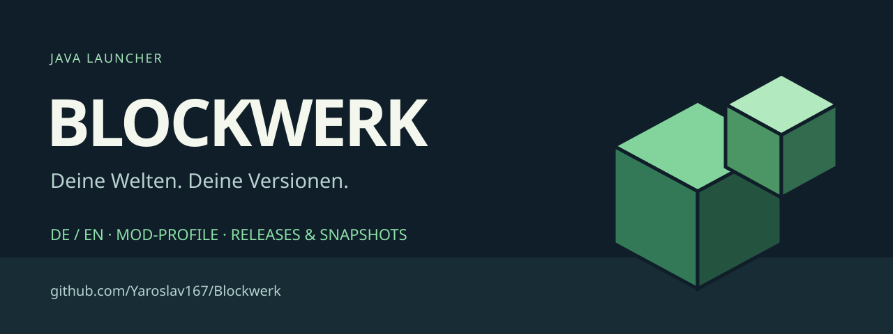

# Blockwerk · Deine Welten. Deine Versionen.

Ein unabhängiger Minecraft-Java-Launcher mit deutscher und englischer Oberfläche.

**[Downloads & Installation](https://github.com/Yaroslav167/Blockwerk/releases/latest)** · **[Feedback](https://github.com/Yaroslav167/Blockwerk/issues)** · **[Builds & Tests](https://github.com/Yaroslav167/Blockwerk/actions)**

## Entdecke Blockwerk

- **Releases und Snapshots:** getrennte Auswahl mit Suche, inklusive historischer Vollversionen ab 1.0.
- **Lokale Welten:** vorhandene Java-Welten ansehen und geschützte Spielkopien verwenden.
- **Mod-Profile:** Fabric, Forge, Quilt und NeoForge. Mods müssen zu Spielversion und Loader passen.
- **Skins:** eigene PNGs importieren, Classic/Slim wählen und die Figur in 3D ansehen. Lokale Darstellung ist kein Konto-Upload.
- **Server-Favoriten:** gespeicherte Server ohne Fünferlimit. Der Server muss lokale Profile erlauben.
- **Deutsch / English:** direkt im Launcher umschalten.
- **Launcher-Updates:** wöchentliche Prüfung während der Nutzung, Installation nach eigenem Klick.

## Downloads

Alle verfügbaren Pakete und der konkrete Teststand stehen auf der **[Release-Seite](https://github.com/Yaroslav167/Blockwerk/releases/latest)**.

| System | Start |
|---|---|
| Windows x64 | ZIP vollständig entpacken, `Blockwerk.exe` starten. |
| macOS Apple Silicon / Intel | Beim nativen Paket: `.app` aus dem passenden Architektur-Archiv verwenden. Quellpakete sind separat gekennzeichnet. |
| Linux x64 / ARM64 | Beim nativen Paket: Archiv vollständig entpacken und `Blockwerk` aus dem Ordner starten. Quellpakete sind separat gekennzeichnet. |

Native Pakete bringen Python und Qt mit. Minecraft benötigt zusätzlich eine passende Java-Laufzeit. Die Pakete sind nicht mit einem Herausgeberzertifikat signiert oder Apple-notarisiert. Automatische Starttests sind keine vollständigen Minecraft-Spiel- oder Kontotests.

## Anmeldung: aktueller Stand

Eine eigene öffentliche Microsoft-App-ID ist hinterlegt. **Die Minecraft-API-Freigabe bleibt offen.** Erfolgreiche echte Minecraft-Anmeldung, Konto-Skin-Uploads, Realms und authentifizierte Serverbeitritte sind deshalb nicht bestätigt. Der lokale Modus bleibt erhalten. [Details](AUTH-STATUS.md).

Minecraft selbst ist nicht enthalten. Unabhängiges Projekt; nicht von Mojang oder Microsoft unterstützt.

## English

**Your worlds. Your versions. Your Blockwerk.** An independent Minecraft Java launcher with German/English UI, release/snapshot selection, local worlds, skin previews and Fabric/Forge/Quilt/NeoForge profiles.

Get available packages from the **[latest release](https://github.com/Yaroslav167/Blockwerk/releases/latest)**. Native bundles include Python and Qt; source packages are labeled separately. Mods must match the game version and loader. Local profiles can only join servers that permit them. Minecraft is not included. Minecraft API approval remains pending; successful authenticated Minecraft login is not confirmed. Packages are unsigned and not Apple-notarized.

## Dokumentation & Mitmachen

[Einstieg](EINRICHTUNG.md) · [Plattformen](PLATTFORMEN.md) · [Mods & Server](MODS-UND-SERVER.md) · [Welten](WELTEN-UND-SNAPSHOTS.md) · [Skins & Updates](SKINS-UND-UPDATES.md) · [Prüfbericht](PRUEFBERICHT.md)

Fehler bitte mit Betriebssystem, CPU-Architektur, Version und nachvollziehbaren Schritten melden. Keine Passwörter oder Konto-Tokens in Issues veröffentlichen.

[Werbetexte DE/EN](WERBETEXTE.md) · [Lizenz](LICENSE) · [Drittanbieter](THIRD_PARTY.md)

